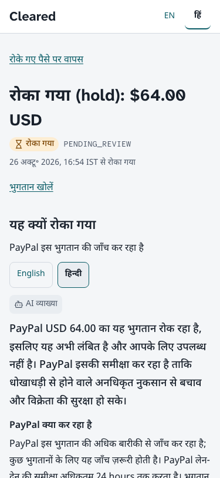
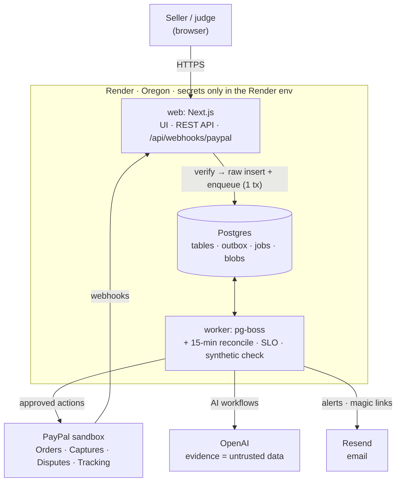
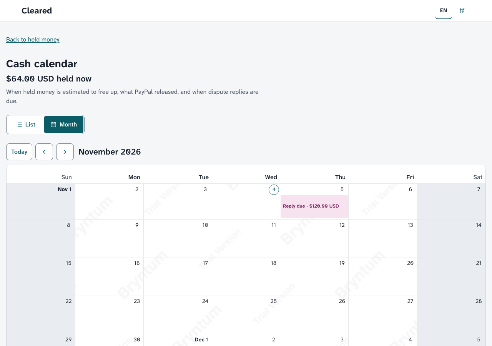
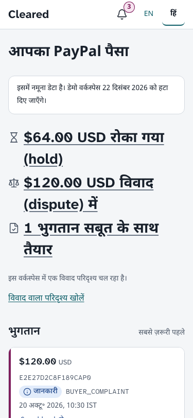
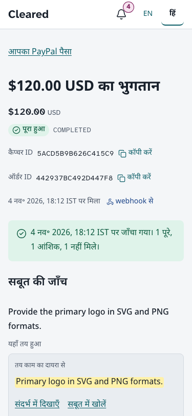

# Cleared

**Your PayPal money, cleared.** An AI agent that keeps small cross-border sellers' PayPal money flowing. It builds proof for every payment as it arrives, explains and works through holds, and answers disputes from that same proof. *The agent does the work; you hold the keys.*

> Built for the PayPal AI Hackathon (2026). Runs on the PayPal **sandbox**: every PayPal call in the demo is a real sandbox call, and every person, chat and file in it is synthetic.

- **Hosted demo:** https://cleared-web-gd1b.onrender.com. Press **Try as demo seller**: no PayPal account and no keys needed.
- **Video (< 3 min):** <!-- Filled by M5-02: the YouTube video link -->
- **Licence:** [MIT](LICENSE)


## Problem

Freelancers and small sellers in India, Kenya, Nigeria and beyond get paid through PayPal by clients they have never met. When PayPal reviews a payment, opens a dispute or asks for documents, the seller's money is held, and the proof PayPal wants is scattered across chats, email, drives and courier slips.

| Pain | In their words | Who suffers |
|---|---|---|
| Earnings frozen with little explanation | "My legitimate freelance earnings are now frozen under an unjustified 180-day hold." ([Trustpilot](https://www.trustpilot.com/review/www.paypal.com?search=india), India, 2026-09-29) · "My funds were locked for 180 days, severely disrupting my livelihood" ([Trustpilot](https://www.trustpilot.com/review/www.paypal.com), Kenya, 2025-12-29) | freelancers, small sellers |
| Proof demanded after the money is already held | "told me that I needed to provide an invoice or a contract signed by both parties" ([Trustpilot](https://www.trustpilot.com/review/www.paypal.com), 2026-09-22) · "Next is a hold on your suspicious transaction, request additional documents for your own money" ([Hacker News](https://news.ycombinator.com/item?id=50057108), 2026-10-12) | service sellers |
| Disputes lost for lack of organised evidence | "Startup getting spammed with PayPal disputes… support is always extremely slow" ([Hacker News](https://news.ycombinator.com/item?id=44176510)) · a dispute the seller doesn't answer by its due date closes in the buyer's favour | service and digital sellers |
| No warning before it happens | "Don't make users think their account is okay, then limit or hold funds once received." ([WeeTracker](https://weetracker.com/2026/02/24/paypal-nigeria-return-user-complaints-paga/), Nigeria, 2026-02-24) · "Merchants often don't realize they're carrying risk exposure until funds are frozen" ([Hacker News](https://news.ycombinator.com/item?id=47124945), 2026-02-23) | all sellers |

The quotes are public reviews and posts, quoted verbatim and dated; the Trustpilot links open PayPal's review page, where each review can be found by its date. Our reading (an inference, not a measurement): most of this pain falls on sellers who don't know PayPal's published release steps and gather proof only after PayPal asks.

## Solution

Cleared works at three moments, each on real PayPal sandbox state.

1. **A payment arrives → a proof pack.** The webhook brings the capture; the seller adds the agreed scope and the delivery evidence (a pasted chat, files, a client acknowledgement link). The AI turns the scope into checkable lines and marks each one *met*, *partly met*, *missing* or *can't verify*. Every verdict cites a quote, and code checks that each quote appears **verbatim** in the stored evidence before it is shown. A quote that fails the check is dropped, and the line becomes *can't verify*.
2. **Money is held → an explanation and the next step.** A hold is a capture with status `PENDING` and PayPal's reason. Cleared explains it in the seller's language (English or Hindi), shows an **estimated** release date with the PayPal rule it comes from, and offers the step PayPal publishes: file tracking for goods, or record a service as Completed.
3. **A dispute arrives → a reply drafted from the pack.** The agent maps the reason code, picks the evidence, writes the notes (≤ 2,000 characters) and compiles one PDF. The seller reviews exactly what PayPal will receive, approves, and Cleared files it through the Disputes API. When PayPal decides, Cleared mirrors the outcome. In the sandbox that reads "resolved; the seller keeps the money (PayPal covered the case)", and the held payment returns to `COMPLETED`.

**The agent does the work; you hold the keys.** The agent can only *propose* an action. Nothing reaches PayPal until the seller approves, and the approval is bound to the sha256 of the exact payload, so a changed draft needs a new approval. Before sending, Cleared re-fetches the dispute, checks that PayPal still offers that action (its HATEOAS links), and refuses within 1 hour of the reply deadline. Accepting a claim needs typed confirmation and is never automatic. Every step lands in an append-only audit log the seller can read, and a kill switch stops all agent actions.

Also in the product: a cash calendar of estimated releases and reply deadlines, carrier route advice for goods sellers, an in-app notification centre and email deadline alerts.

| Proof pack: each scope line with its verdict and the verbatim quotes that support it | Hold explanation in Hindi, on a phone |
|---|---|
|  |  |

## Why now

- **PayPal's developer platform is ready for agents.** The sandbox exposes the whole dispute lifecycle by API: create a chargeback, file evidence, and adjudicate, so an agent's work can be shown end to end on real PayPal state rather than in a mock-up.
- **Verifiable AI extraction became cheap.** Structured outputs (strict JSON schemas) make a model's answer machine-checkable, and a small model is enough for most of the work. Checking one proof pack against its scope costs **$0.0070** in model spend ([eval report](docs/evidence/eval-report.md)).
- **Cross-border freelance selling keeps growing**, and the sellers it adds are often new accounts in emerging markets: the accounts most likely to see a hold, and the least likely to know how one is released.

## Architecture

A modular monolith on Render: a Next.js web service (UI, REST API, webhook endpoint), a background worker (pg-boss queues on Postgres), and Postgres as the system of record. The webhook verifies the signature, stores the raw event and enqueues its job in one transaction, then acknowledges; the worker re-fetches the resource from PayPal and never trusts event order. Every outbound call goes through one HTTP client with timeouts and retries only on timeouts, 5xx and 429.



More: [system design](docs/architecture.md), [the architecture decisions (ADRs)](docs/adr/), [threat model](docs/security/threat-model.md), [design system and screen specs](docs/design/README.md), [judging-window runbook](docs/operations/judging-runbook.md).

### PayPal APIs actually used

All calls go through Cleared's own typed client ([ADR 0011](docs/adr/0011-http-client-reliability.md)). Each endpoint below has a recorded sandbox exchange in [`fixtures/paypal/`](fixtures/paypal/), which the tests replay.

| API | Endpoints | What Cleared does with it |
|---|---|---|
| OAuth 2.0 | `POST /v1/oauth2/token` | app access token |
| Orders v2 | `POST /v2/checkout/orders`, `GET /v2/checkout/orders/{id}`, `POST /v2/checkout/orders/{id}/capture` | the demo's test payments (each order's `custom_id` is the owning workspace) |
| Payments v2 (captures) | `GET /v2/payments/captures/{id}` | the source of truth for status and hold reason, re-fetched on every webhook |
| Disputes | `GET /v1/customer/disputes`, `GET /v1/customer/disputes/{id}`, `POST /v1/customer/disputes/{id}/provide-evidence`, `POST /v1/customer/disputes/{id}/accept-claim` | mirror disputes; file the approved reply and evidence; accept a claim (typed confirmation) |
| Disputes, sandbox only | `POST /v2/customer-support/process-chargeback`, `POST /v1/customer/disputes/{id}/require-evidence`, `POST /v1/customer/disputes/{id}/adjudicate` | create the demo chargeback; the labelled "Simulate PayPal's decision (sandbox only)" step |
| Order Tracking | `POST /v2/checkout/orders/{id}/track` | file a shipment's carrier and tracking number (approved action) |
| Tracking (legacy) | `POST /v1/shipping/trackers-batch`, `GET /v1/shipping/trackers/{id}` | record a service as Completed (status `COMPLETED`, no carrier, no tracking number: PayPal refuses a carrier without one); read a tracker back |
| Webhooks | `POST /v1/notifications/webhooks`, `GET /v1/notifications/webhooks`, `POST /v1/notifications/verify-webhook-signature` | register the app's webhook (`scripts/setup.ts`); verify each delivery (self-verified against PayPal's certificate, with PayPal's verify call as the fallback) |

Transaction Search is not used, so payments made outside Cleared's own app are not visible (see [Limits](#limits)).

### AI tools and how they're used

**In the product: OpenAI**, through the `openai` SDK (Responses API, strict JSON-schema outputs re-validated with zod) behind an adapter ([ADR 0009](docs/adr/0009-ai-workflows-openai.md)). The model IDs are pinned: `gpt-6-luna` (small) and `gpt-6.1-terra` (large). There is no open agent loop: four fixed workflows.

| Workflow | Model | What it does |
|---|---|---|
| `extract` | `gpt-6-luna` | structured facts (amounts, dates, people, deliverables) from pasted text, images and PDFs |
| `check_scope` | `gpt-6.1-terra` | two passes: pass 1 turns the scope into claim lines, pass 2 matches each line to quoted spans in the evidence. Then code checks every quote verbatim; an uncited *met* or *partly met* line becomes *can't verify* |
| `explain_hold` | `gpt-6-luna` | a plain-language explanation of a hold in English or Hindi, grounded in a maintained table of PayPal's published rules, each with its source |
| `draft_dispute` | `gpt-6.1-terra` | the dispute reply: reason-code mapping, evidence selection, notes ≤ 2,000 characters |

**Guardrails** ([ADR 0010](docs/adr/0010-agent-governance.md)): evidence and tool output are data, never instructions (evidence goes in delimited blocks, an injection scan flags instruction-like lines, and model output is rendered as plain text); at most 6 model calls per run, with token and time caps; spend caps of $0.10 per demo workspace and $1 per day overall; an AI cache keyed on the input hash; and graceful degradation (no verdict, never a made-up one) when the model is unavailable. Prompt, model or schema changes merge only with the evals green; the results are under [Measured results](#measured-results).

**To build it: Claude Code** (Anthropic) wrote most of the code, tests and documentation under the author's direction and review, and Claude labelled the synthetic gold sets that the OpenAI models are evaluated against (cross-checked by a second model). Claude is not part of the running product.

## Demo

Open https://cleared-web-gd1b.onrender.com and press **Try as demo seller**. You get your own isolated workspace (sample data, no keys). Every PayPal step below is a real sandbox call.

1. **Dashboard.** "Your PayPal money": what is held, what is in dispute, and which payments are proof-ready.
2. **Start the dispute scenario.** Cleared creates a sandbox card payment through Orders v2; the webhook brings it in within seconds.
3. **Proof pack.** Synthetic client files are attached and the AI checks delivery against scope, with verbatim citations (about 30 seconds).
4. **A real hold.** Cleared raises a sandbox chargeback; PayPal puts the capture on `PENDING / BUYER_COMPLAINT` and opens the dispute. In our production run this took about 3 minutes after the payment.
5. **Review and approve.** The agent's reply is ready about a minute later. You see exactly what PayPal will receive (the notes and one compiled PDF), approve, and Cleared files the evidence.
6. **Simulate PayPal's decision (sandbox only).** In production PayPal's own team decides a case, which no demo can wait for. The sandbox has an `adjudicate` call for testing, and this clearly labelled control makes that call. It unlocks a few minutes after filing (about 4 minutes in our run) because PayPal must first process the evidence.
7. **The outcome, mirrored from PayPal.** The dispute becomes `RESOLVED` (`RESOLVED_WITH_PAYOUT`, `REPRESENTED_BY_PAYPAL`), shown as "resolved; the seller keeps the money (PayPal covered the case)", and the hold is released: the capture is `COMPLETED` again. In our run this came about 6 minutes after the decision.

The whole path took about 15 minutes in our production dry run ([timings](docs/evidence/m3-storyboard-dry-run.md)). The final production run on 2026-11-04 filed tracking on a review hold, filed a dispute reply, recorded a service as Completed through `trackers-batch` (PayPal answered 200), and took the labelled sandbox decision through to `RESOLVED` and a released hold ([gate record](https://github.com/thopatevijay/cleared/issues/52#issuecomment-6629753360)).

| | |
|---|---|
|  |  |
|  |  |
|  |  |

These screenshots come from a local build with seeded synthetic data; the hosted demo shows the same screens.

## Measured results

<!-- eval:start -->
Measured on the `test` split of the synthetic gold sets: gold set labelled by Claude (independent of the OpenAI models under test), cross-checked by a second model (kappa = extraction 0.843, scope 0.834, holds 0.626). Models: `gpt-6-luna` (extract, explain), `gpt-6.1-terra` (scope check); explanations judged by `gpt-6.1-terra` for "fact conveyed" only. Full report: [docs/evidence/eval-report.md](docs/evidence/eval-report.md).

| What | Result | n | Target |
|---|---|---|---|
| Scope check (line verdicts) | 95.2% (118/124; 95% CI 89.8%–97.8%) | 31 packs | ≥ 90%: met |
| Citations verbatim | 100.0% (349/349; 95% CI 98.9%–100.0%) | 349 citations | 100%: met |
| Fact extraction (fields) | 95.8% (115/120; 95% CI 90.6%–98.2%) | 22 items | ≥ 90%: met |
| Hold explanations (all checks) | 62.5% (10/16; 95% CI 38.6%–81.5%) | 16 explanations | ≥ 95%: **MISS** |
| Adversarial cases | 100.0% (22/22; 95% CI 85.1%–100.0%) | 22 cases | 100%: met |

Disclosures: The eval judge was revised to `eval_judge@v2` after run 1's test-split results had been seen (run 1's numbers are kept in the PR record). The holds prompt `explain_hold@v2` was tuned on the dev split only (hold-07, hold-10). Holds missed the 95% bar in runs 1, 2 and 3 and are reported as a miss (owner accepted 2026-11-04). The threshold, the judge and the gold were not changed to pass it. Holds gold labels may be wrong where the rule source states the fact verbatim (hold-10 `kyc_incomplete` is labelled unverifiable); an audit would be a disclosed post-hoc correction (BL-01). Live spend across all runs: $0.6582 (smoke runs x3 (holds, dev split) $0.0180; run 1 (all sets, test split) $0.3102; run 2 (all sets, test split) $0.2915; dev runs x2 (holds, dev split) $0.0120; worker fixtures (explain_hold@v2, 4 answers) $0.0007; run 3 (holds only, test split, explain_hold@v2) $0.0258). Replayed from recordings at commit `2deab57`.
<!-- eval:end -->

The miss in detail ([eval report](docs/evidence/eval-report.md), [JSON](docs/evidence/eval-report.json)): a hold explanation passes only when it conveys every expected fact, cites the right rule, and is in the right language. Facts conveyed: 58/64. Right rule: 16/16. Right language: 16/16. EN/HI pairs that agree: 8/8. Forbidden claims (such as a promised release date): 0. Scope-check macro-F1 is 0.945.

**Accessibility (WCAG 2.2 AA)** ([report](docs/evidence/a11y-report.md)): axe reports no violation of any impact on every route × EN/HI × populated/empty/loading/error state; the judge path works keyboard-only at 1280 and 375 px; pages reflow without horizontal scroll at 320 px and at 200 % zoom; the VoiceOver pass (macOS and iOS Safari) was run by the owner on 2026-11-04 and passed.

**Performance** ([report](docs/evidence/perf-report.md)): the dashboard's first-load JavaScript is **185.0 KB** gzip, within its 200 KB budget. Lighthouse (mobile simulation, localhost, report-only): 6 of 8 audited routes within LCP ≤ 3.2 s / TBT ≤ 200 ms. Accepted misses: `/hi/payments` LCP 3.77 s (the Devanagari fonts) and `/en/calendar` TBT 252 ms.

**Load**:
- A 100× webhook burst on a local production build: 2,100 events, ack p95 **15.7 ms**, 0 duplicates, 0 dead letters, queue drained in **35 s** ([load report §1](docs/evidence/load-report.md#1-100-webhook-burst-local-production-like-stack)).
- Production webhook ack, server-side: p95 **1 ms** ([§2](docs/evidence/load-report.md#2-production-webhook-burst)).
- Production launch load (20 concurrent sessions on Render's Starter plan): overall p95 **949.4 ms** against a target of 800 ms: **not met** ([launch load](docs/evidence/load-report.md#production-launch-load)). The production database (0.1 CPU) is the bottleneck; a fix that cuts its idle load is in progress, and no result is claimed for it yet.

## Limits

- **Sandbox only.** Nothing touches live PayPal money. The "Simulate PayPal's decision (sandbox only)" step stands in for PayPal's own review, and it is labelled as such everywhere it appears.
- **Only payments made through Cleared's app arrive.** PayPal webhooks are scoped to the app, and Transaction Search is not used, so payments taken elsewhere are not visible.
- **Release dates are estimates**, from PayPal's published rules, and each one shows its source. Cleared doesn't lift limitations, release money or promise a release date: PayPal decides.
- **Sample scenarios.** The sandbox can't produce new-seller holds, reserves or account limitations, so these appear only as badged sample scenarios. There is no document pack for an account limitation.
- **The sandbox outcome.** A sandbox dispute resolves as "PayPal covered the case": the seller keeps the money, which is not the same as a decision in the seller's favour.
- **Visual citation is not built.** Quotes are checked in text (pasted chat, PDF text layers). Support that exists only in a screenshot or photo is marked *can't verify* (`unverifiable`).
- **Stored PDFs and images are rewritten for safety.** PDFs are re-saved page by page, which drops links, form fields, bookmarks, attachments and metadata (the visible page and its text layer are kept); images are re-encoded without EXIF, so a photo's capture date and place are not kept.
- **Recording a service as Completed** sends PayPal status `COMPLETED` with no carrier and no tracking number (PayPal refuses a carrier without one). Its effect on a hold's release is not confirmed, and the screen says so.
- **Carrier route advice** uses PayPal's two carrier lists for the tiers. Many carriers are listed by PayPal as `GLOBAL`, so Cleared derives a carrier's country from its code; this mapping is Cleared's, not PayPal's, and only orders the advice.
- **Goods tracking automation is PayPal's own product.** Cleared files tracking as one approved action, not as a sync.
- **Measured misses** are reported above, not hidden: hold explanations below their target, one Lighthouse LCP and one TBT miss, and production latency under launch load.

## Future vision

- **v2: platform mode.** Through PayPal's partner model, marketplaces and freelance platforms run Cleared for all their sellers, with each seller's consent.
- **v3: the cash-flow layer.** True take-home after FX and fees, and when held money will really be available, using PayPal's currency exchange APIs.
- **v4: proof travels with every payment.** A proof pack readable by PayPal, by buyers and by buyers' AI agents, so a dispute starts from evidence rather than from a request for it.

## How to run

### Deploy your own copy

[](https://render.com/deploy?repo=https://github.com/thopatevijay/cleared)

The button works once this repository is public. It creates the [`render.yaml`](render.yaml) Blueprint: a web service, a background worker and Postgres 18, in Oregon, on starter plans (about $20/month, see [docs/budget.md](docs/budget.md)). Every deploy runs the database migrations first, and the web service answers `GET /healthz` with the deployed commit.

Render asks for these values once, on the web service; the worker reads them from there. Use PayPal **sandbox** credentials only.

| Variable | What it is |
|---|---|
| `PAYPAL_CLIENT_ID`, `PAYPAL_CLIENT_SECRET` | a PayPal sandbox REST app (developer.paypal.com → Apps & Credentials → Sandbox) |
| `PAYPAL_WEBHOOK_ID` | the sandbox webhook id for `<your web URL>/api/webhooks/paypal` |
| `OPENAI_API_KEY` | an OpenAI API key |
| `RESEND_API_KEY`, `EMAIL_FROM`, `EMAIL_RECIPIENT_ALLOWLIST` | a Resend sending key, the sender, and the only addresses that may receive email |
| `SENTRY_DSN` | a Sentry project DSN |

`SESSION_SECRET` and `ENCRYPTION_KEY` are generated by Render. The database URL is wired in automatically.

### Run it locally

Needs Node 24, pnpm 12 and Docker.

```bash
pnpm install
cp .env.example .env        # then fill in the values (sandbox credentials only)
make up                     # Postgres in Docker, migrations applied
pnpm db:seed                # a seed workspace
set -a; . ./.env; set +a    # export the values for the web app and the worker
pnpm dev                    # web on http://localhost:3000 and the worker
```

`make reset` starts again from an empty database. `PORT_OFFSET=100 make up` moves Postgres to port 5532 if 5432 is taken.

### Environment variables

From [`.env.example`](.env.example) (names only; never commit values):

| Variable | What it is for |
|---|---|
| `NODE_ENV`, `APP_BASE_URL` | runtime mode; the public base URL used in links and emails |
| `SESSION_SECRET` | signs session cookies |
| `ENCRYPTION_KEY` | 32-byte base64 key for AES-256-GCM encryption of stored secrets |
| `AGENT_KILL_SWITCH` | `true` stops every agent-initiated action |
| `DATABASE_URL` | Postgres connection string |
| `PAYPAL_ENV` | `sandbox` (the only supported value) |
| `PAYPAL_CLIENT_ID`, `PAYPAL_CLIENT_SECRET` | the PayPal sandbox REST app |
| `PAYPAL_WEBHOOK_ID` | the id of the webhook registered by `scripts/setup.ts`, used to verify deliveries |
| `OPENAI_API_KEY` | OpenAI API key |
| `OPENAI_MODEL_SMALL`, `OPENAI_MODEL_LARGE` | the pinned model IDs |
| `LLM_DAILY_CAP_USD`, `LLM_WORKSPACE_CAP_USD` | model spend caps: per day overall, per demo workspace |
| `RESEND_API_KEY`, `EMAIL_FROM` | email sending (magic links, alerts) |
| `EMAIL_RECIPIENT_ALLOWLIST` | when set, email goes only to these addresses |
| `SENTRY_DSN`, `LOG_LEVEL` | error tracking; log level |
| `DEMO_WORKSPACES_PER_IP_PER_DAY`, `DEMO_WORKSPACES_GLOBAL_MAX` | limits on "Try as demo seller" |
| `RENDER_WEB_URL` | the public URL of the deployed web service (setup script default) |
| `E2E_BASE_URL` | run the Playwright tests against a deployed URL instead of a local build |
| `EVAL_MAX_USD` | spend cap for one live eval run |
| `BRYNTUM_NPM_TOKEN` | optional: Bryntum's private registry, only for a licensed calendar build |

### PayPal sandbox setup

1. At developer.paypal.com, create a **sandbox** REST app (Apps & Credentials → Sandbox) and put its client id and secret in `.env`.
2. Make your web URL reachable by PayPal (your Render URL, or a tunnel such as `cloudflared` for local work).
3. Register the webhook (idempotent; it prints the webhook id):
   ```bash
   pnpm tsx --env-file=.env scripts/setup.ts --url https://<your web URL>
   ```
4. Put the printed id in `PAYPAL_WEBHOOK_ID` (in `.env` and in Render).

### Tests

```bash
pnpm typecheck && pnpm lint && pnpm test      # unit and integration tests (replay recorded PayPal and OpenAI exchanges)
pnpm --filter @cleared/web build
pnpm --filter @cleared/web exec playwright test # end-to-end, local build, PayPal answered from the recorded fixtures
pnpm eval:validate && pnpm eval                 # evals, replayed from recordings (no model spend)
pnpm readme:check && pnpm eval:check-readme     # this README's claims against the fixtures and reports
```

The tests use recorded real sandbox responses; the running product calls the real PayPal sandbox and the real OpenAI API.

## Retention

The demo's data is synthetic. Demo workspaces expire on 2026-12-16, and all demo data is deleted on 2026-12-22 ([ADR 0020](docs/adr/0020-demo-retention-purge.md)).

## License

[MIT](LICENSE)
