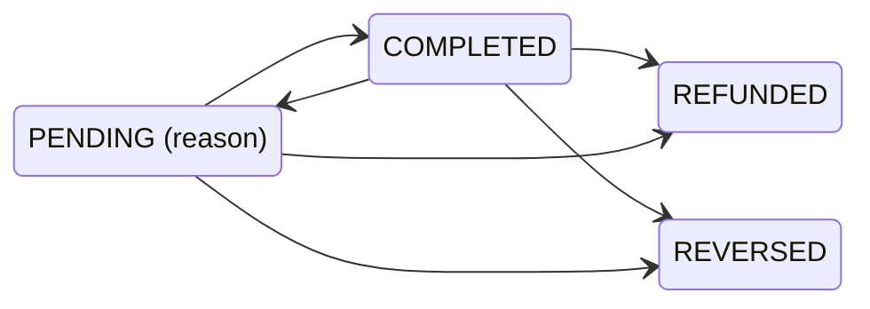
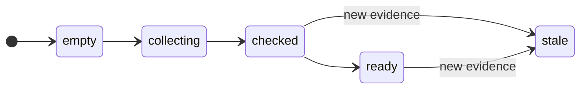
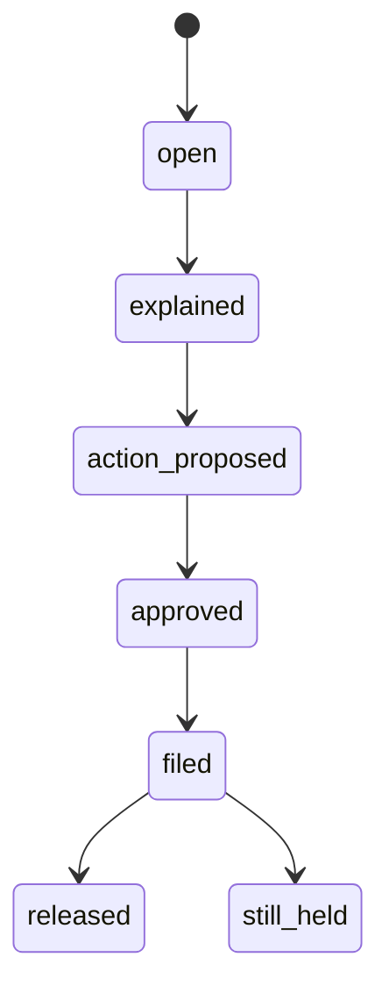
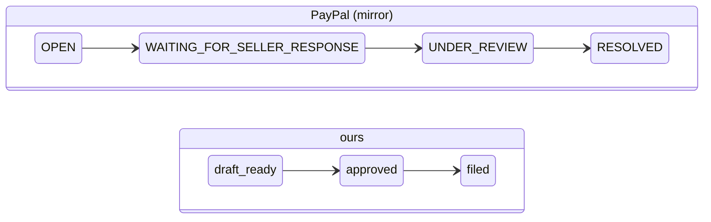
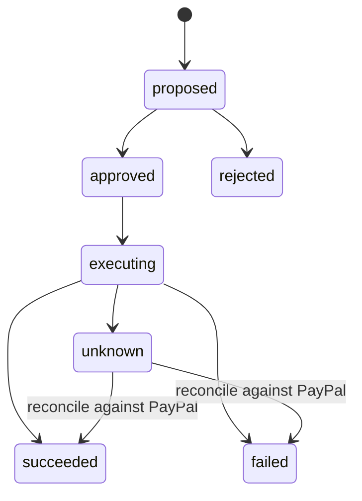
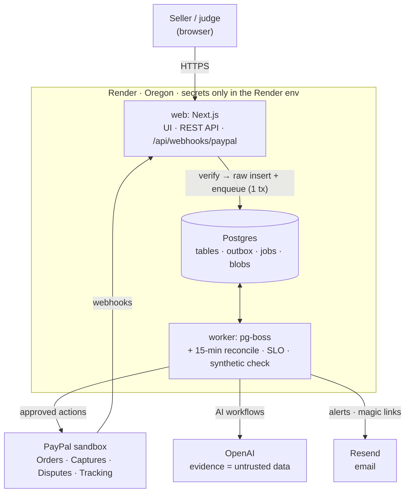
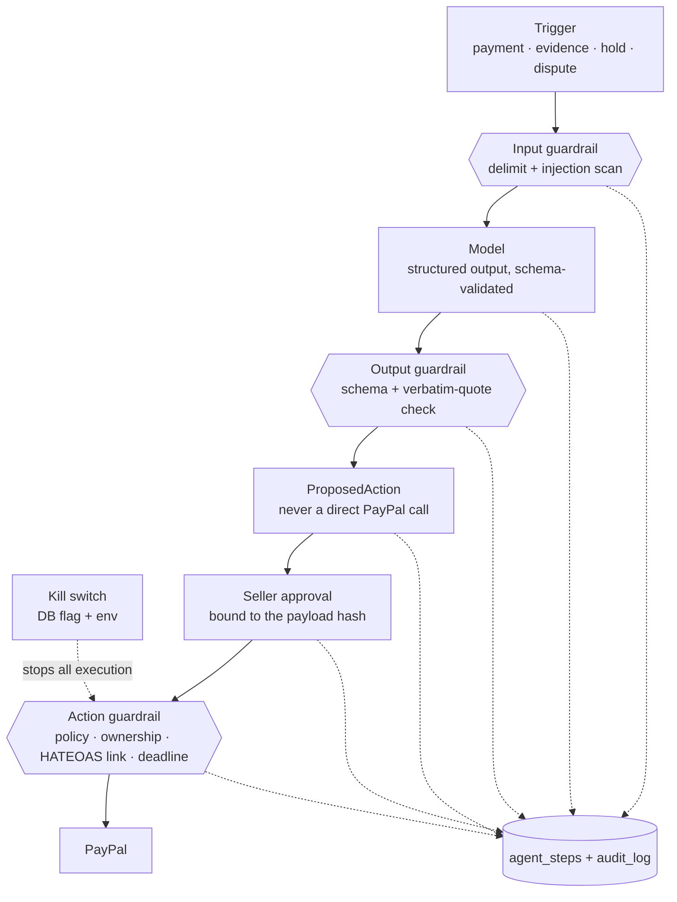

# Cleared: system design

Cleared is an AI agent that keeps a small cross-border seller's PayPal money flowing:

- It builds a **proof pack** as each payment arrives, and an AI checks delivery against the agreed scope.
- It explains **held money** and takes PayPal's published release steps.
- It answers **disputes** and PayPal's document requests from that same pack.

**The agent does the work; the seller holds the keys.** Nothing reaches PayPal without the seller's approval.

This document is the public system design. Each decision links to its ADR in [`adr/`](adr/); the ADRs hold the reasoning.

## 1. Requirements

Each line is marked **K** (known, with its source) or **A** (assumed, with how it is validated).

| Area | Requirement | Status |
|---|---|---|
| Functional | Core flow on the PayPal sandbox: webhook → proof pack → hold → dispute → evidence filed → resolved → hold released | K: live spike 2026-10-26/28 |
| Functional | A judge can run the whole flow themselves, with no keys, in an isolated demo workspace | K: hackathon rules (functional demo; judges have no keys) |
| Load (launch) | ≤ 50 sellers, ≤ 200 demo workspaces, ≤ 20 concurrent judge sessions, ≤ 500 payments | A: audit log during judging |
| Load (100×) | ~5,000 sellers, ~50k payments/month (~0.02 writes/s average), webhook bursts ≤ 5/s; read:write ≈ 20:1 | A: arithmetic |
| Latency | Webhook ack < 500 ms; dashboard p95 < 800 ms; scope check < 30 s and dispute draft < 60 s (both async) | A: measured from M1 |
| Availability | 99% through the judging window (until 2026-12-15); RPO 24 h; RTO 1 h | A |
| Data | Relational core; evidence files ≤ 10 MB each (PayPal evidence limit), ~20 MB per pack; < 1 GB at launch; strong consistency for money, actions and approvals | K: PayPal Disputes API limits |
| Security | Minimum PII (India DPDP Act, GDPR principles); synthetic personas in the demo; secrets only in the platform environment | K |
| Global | EN + HI at launch; original and receivable currency as PayPal returns them; UTC stored, seller time zone shown; WCAG 2.2 AA | K |
| Budget | Launch ceiling ≤ $50/month (≈ $20 hosting + LLM hard cap $1/day). The 100× figure comes from the per-pack cost measured in M0 | A: M0 spike + owner approval |
| Feedback loops | Local check ≤ 2 min; PR CI ≤ 5 min; environment reset ≤ 2 min | K: engineering standard |

## 2. Domain model

**Modules (bounded contexts):**

| Module | Owns |
|---|---|
| Accounts | Workspaces (seller or demo), sessions, the platform's sandbox connection |
| Payments | Payments mirrored from PayPal captures; raw webhook events |
| Proof | Proof packs, immutable evidence items, extracted facts, scope checks with citations, client acknowledgements |
| Holds | Holds (a capture in `PENDING`, plus its reason), explanations, estimated release dates |
| Disputes | Disputes mirrored from PayPal, deadlines, response drafts |
| Actions | Proposed actions, approvals, executions, the append-only audit log |
| Agent runs | AI workflow runs, steps, tokens, cost, limits |

**Invariants:**

- Payment and dispute states **mirror PayPal**. Cleared never invents a PayPal state; every change records its source (webhook or poll).
- Every PayPal resource Cleared touches has **exactly one owner workspace** (`paypal_resource_owner`). Anything without an owner is quarantined.
- Evidence is **immutable**: append-only, with a sha256 per item.
- Every scope verdict cites a span that appears **verbatim** in stored evidence, or is marked `unverifiable`.
- An approval is bound to the **sha256 of the exact draft** it approved.
- No action runs after `seller_response_due_date − 1 h`, or without the matching PayPal action link at execution time.

**State machines:**

*Payment* (mirror only: Cleared records what PayPal reports and never invents a state)

*ProofPack*

*Hold*

*Dispute*: PayPal's states (mirror) and our draft states

*ProposedAction*

**Events** (outbox, each with a `version` field): `payment.captured`, `payment.status_changed`, `evidence.added`, `pack.checked`, `hold.opened`, `hold.released`, `dispute.opened`, `dispute.status_changed`, `action.approved`, `action.executed`, `action.failed`, `action.unknown`.

## 3. Decisions

| Area | Decision | ADR |
|---|---|---|
| Style | Modular monolith in TypeScript: `apps/web` (Next.js UI, API, webhook) + `apps/worker` (background jobs) + `packages/core` (domain, no I/O) + `packages/adapters` + `packages/db` | [0001](adr/0001-modular-monolith.md) |
| Data | Postgres is the system of record for everything; evidence blobs in Postgres behind a BlobStore adapter; Drizzle migrations | [0002](adr/0002-postgres-system-of-record.md) |
| API | REST with shared zod schemas, one error envelope, Idempotency-Key on mutations | [0003](adr/0003-rest-zod-contracts.md) |
| Async | pg-boss in the same Postgres; transactional outbox; idempotent consumers; reconcile poll | [0004](adr/0004-pgboss-outbox.md) |
| Frontend | Next.js App Router, Tailwind, next-intl, WCAG 2.2 AA; one Bryntum calendar behind `CashCalendar` | [0005](adr/0005-nextjs-frontend.md) |
| Seller connection | Hackathon: the platform's own sandbox REST app acts as the connected merchant. Production: PayPal's partner model behind the `SellerConnection` interface | [0006](adr/0006-seller-connection.md) |
| Identity | Email magic links for sellers; anonymous, rate-limited demo workspaces for judges | [0007](adr/0007-auth-and-demo-workspaces.md) |
| Resource ownership | Every PayPal resource is tagged (`custom_id = workspace_id`) and recorded in `paypal_resource_owner` | [0008](adr/0008-resource-ownership.md) |
| AI | Deterministic workflows on OpenAI with structured outputs; two-pass scope check with a verbatim-quote check; the agent only proposes actions | [0009](adr/0009-ai-workflows-openai.md) |
| Agent governance | Approval bound to the draft hash, policy in code, kill switch, caps, append-only audit log | [0010](adr/0010-agent-governance.md) |
| Reliability | One shared HTTP client (timeouts, retries on 5xx/429/timeout, Retry-After); graceful degradation; deadline watcher | [0011](adr/0011-http-client-reliability.md) |
| Webhooks | Self-verified signatures with a certificate-host allowlist; raw store + dedupe + enqueue in one transaction | [0012](adr/0012-webhook-ingest.md) |
| Observability | pino JSON logs with correlation IDs, run traces in the database, Sentry, SLO checks in the reconcile job | [0013](adr/0013-observability.md) |
| Delivery | Render Blueprint (web, worker, Postgres, Oregon), docker compose locally, GitHub Actions with a pnpm cache, MIT licence | [0014](adr/0014-render-delivery.md) |
| Notifications | Email (Resend) for deadline and hold/dispute alerts and magic links; an in-app notification centre | [0015](adr/0015-email-notifications.md) |

## 4. System diagram

Trust boundaries: browser | web | worker + DB | PayPal | OpenAI | Resend.

## 5. Data model

All tables carry `workspace_id`, except platform tables. Timestamps are UTC `timestamptz`.

| Table | Key columns | Notes |
|---|---|---|
| `workspaces` | id, kind (`seller` \| `demo`), locale, tz, base_currency, created_at, expires_at | demo workspaces expire after 2026-12-16 and are purged 12-22 |
| `users`, `sessions`, `magic_links` | email (sellers only), token hash, expires_at | demo sessions carry no email |
| `paypal_resource_owner` | (resource_type, resource_id) PK, workspace_id | written when Cleared creates the resource |
| `webhook_events` | (provider, event_id) unique, type, raw jsonb, verified, received_at | raw first, dedupe by unique key |
| `payments` | capture_id unique, order_id, amount, currency, receivable_amount, receivable_currency, status, status_reason, source, synced_at | mirror of the PayPal capture |
| `proof_packs` | payment_id unique, state, checked_at | 1:1 with a payment |
| `evidence_items` | pack_id, kind (`scope` \| `delivery` \| `communication` \| `shipment` \| `invoice` \| `scope_snapshot` \| `client_ack`), blob_id, sha256, text, created_at | immutable |
| `blobs` | id, mime, bytes (bytea), size, sha256 | BlobStore adapter; move to S3 at > 5 GB |
| `extracted_facts` | evidence_item_id, facts jsonb, model, run_id | structured extraction output |
| `scope_checks` | pack_id, line, verdict (`met` \| `partial` \| `missing` \| `unverifiable`), citations jsonb (evidence_item_id, quote, offsets) | quotes verified verbatim |
| `client_acks` | pack_id, token_hash, accepted_at, ip, user_agent | buyer-side acknowledgement |
| `holds` | payment_id, type, reason, opened_at, released_at, estimated_release_at, estimate_source | derived from the payment status |
| `explanations` | hold_id, locale, text, source_ref | grounded in the rule table |
| `disputes` | dispute_id unique, payment_id, reason, stage, status, seller_response_due_date, outcome jsonb, allowed_actions jsonb | mirror of PayPal plus its HATEOAS links |
| `dispute_drafts` | dispute_id, notes (≤ 2000 chars), evidence_item_ids, compiled_blob_id, sha256 | |
| `proposed_actions` | id, kind, payload jsonb, payload_sha256, state, risk, created_by_run_id | the agent can only insert here |
| `approvals` | action_id, approved_by, approved_at, payload_sha256 | bound to the draft hash |
| `executions` | action_id, idempotency_key unique, attempt, paypal_status, paypal_debug_id, response jsonb | |
| `audit_log` | id, at, actor (`seller` \| `agent` \| `system`), action, detail jsonb | append-only (no UPDATE/DELETE grants) |
| `agent_runs`, `agent_steps` | task, input_hash, model, tokens_in, tokens_out, cost_usd, latency_ms, status | the content-hash cache keys on input_hash |
| `outbox` | id, topic, version, payload, created_at, published_at | written in the state-change transaction |
| `notifications` | workspace_id, kind, sent_via, sent_at, read_at | |
| `idempotency_keys` | key, route, response_hash, created_at | mutating API routes |

## 6. Events and real-time

- **Outbox:** state changes and their outbox rows are written in one transaction. pg-boss jobs are created in the same transaction, so nothing is lost or duplicated by a crash.
- **Consumers are idempotent:** they key on PayPal IDs and outbox IDs, use exponential backoff with jitter, and send failures to a dead-letter queue.
- **Webhooks** are app-scoped and PayPal doesn't guarantee their order. Every event triggers a **re-fetch** of the resource, and a **reconcile poll** (every 15 min) covers known open payments and disputes.
- **The UI sees changes** by polling (SWR) every 5 s on open screens. That meets the latency requirement without websockets.

## 7. Data and consistency

- A single Postgres primary gives strong consistency for actions, approvals, holds and disputes. **CAP:** consistency is chosen over availability for money and action state. During an outage, actions wait in the queue and are never executed twice.
- Evidence uses content-addressed (sha256) immutable rows. Packs are versioned, so new evidence marks a pack `stale`.
- Backups: Render daily backups (RPO 24 h). Migrations: Drizzle, forward-only, run on deploy.

## 8. Security

**STRIDE threat model of the core flow:**

| Threat | Example | Mitigation |
|---|---|---|
| Spoofing | forged webhooks; stolen sessions | self-verified PayPal signatures with a certificate-host allowlist; httpOnly secure session cookies; magic links are single-use and expire in 15 min |
| Tampering | an edited draft after approval | the approval is bound to the payload sha256; evidence is immutable |
| Repudiation | "I never approved that" | append-only audit log of every approval and execution, including the PayPal debug_id |
| Information disclosure | cross-workspace reads | every query is scoped by workspace; PayPal resources are checked against `paypal_resource_owner` |
| Denial of service | public demo abuse | 3 demo workspaces per IP per day, 200 globally; per-workspace LLM budget; global $1/day cap; a content-hash AI cache |
| Elevation of privilege | prompt injection steering the agent | evidence is data, never instructions (delimited channel plus an injection scan); the agent can only *propose*; policy in code; plain-text rendering of model output |

**Other controls:**

- **Files:** type sniffing, 10 MB / 30-page / 25 MP caps, image re-encoding.
- **Secrets:** only in the platform environment; none in the repo (gitleaks in CI).
- **Dependencies:** audited in CI.
- **PII:** minimal; demo personas are synthetic; demo data is purged on workspace expiry.

## 9. Reliability, observability and SLOs

- **Timeouts:** PayPal 10 s, OpenAI 60 s, Resend 10 s.
- **Retries:** only on timeout, 5xx and 429, with jitter, honouring `Retry-After`.
- **Circuit breaker:** one, in the shared HTTP client.
- **Graceful degradation:**
  - AI down → the pack shows facts without a verdict, and actions stay manual.
  - PayPal down → actions queue, and the UI shows "pending at PayPal".
  - Email down → in-app notifications still work.
- **Health:** `/healthz` (liveness) and `/readyz` (database and queue).
- **Logs and traces:** pino JSON logs with a correlation ID from request → job → PayPal `debug_id`; agent run traces in the database; Sentry for errors.

| SLO | Target |
|---|---|
| Webhook → hold visible | < 2 min, 99% |
| Approved action → PayPal 2xx | < 5 min, 99% |
| Dispute deadlines missed | 0 (alerts at T-72 h and T-24 h) |
| Synthetic judge path | passes daily |

## 10. Agent architecture

**Shape:** deterministic workflows, not an open loop:

| Workflow | Model | What it does |
|---|---|---|
| `extract` | small | structured facts from chats, receipts and PDFs |
| `check_scope` | larger | pass 1 builds the claim list; pass 2 matches each claim to quoted spans; code checks that every quote is verbatim |
| `explain_hold` | small | grounded in a cited rule table |
| `draft_dispute` | larger | mapped to the reason code; ≤ 2000-character notes; selects evidence and compiles one PDF |

Model IDs are verified on the day (M0-07).

**Circuit breakers:** ≤ 6 model calls per run; token caps per step; $0.10 per demo workspace; $1/day globally.

**Evals:** three gold sets (extraction 30, scope 40, hold explanations 20) plus adversarial injection cases.
- PR CI replays recorded responses through deterministic checks.
- A labelled `eval` workflow runs live evals on prompt or model changes, and nightly.
- Results are published as measured numbers with *n*.

## 11. On-chain

Not applicable: Cleared puts nothing on-chain.

## 12. Scaling story and cost at 100×

| Item | Launch | 100× (≈ 50k payments/month) |
|---|---|---|
| Web service | 1 × starter ($7) | 2 × standard (~$50) |
| Worker | 1 × starter ($7), 5 concurrent jobs | 1 × standard ($25), 20 concurrent jobs |
| Postgres | starter ($6), < 1 GB | standard (~$50), ~100 GB evidence moved to S3 (~$3) |
| LLM | ≤ $1/day cap | 50k packs × $0.0073 (median) to $0.0106 (worst) per pack, measured in M0-07 = **$365–$530/month** before caching |
| Email | free tier | ~$20 |

- **Arithmetic:** 50k payments/month ≈ 1.2 AI runs/min on average. Webhook peaks of 5/s are far below one web instance's capacity. pg-boss at 20 concurrent jobs handles bursts with headroom.
- **Main cost driver:** the LLM. Cost per pack is therefore the tracked metric.
- **Next bottleneck:** blob storage in Postgres, which moves to S3 behind the BlobStore adapter at > 5 GB.
